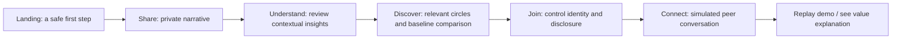

# Beyond Silence | Prototype Build Specification

**Status:** Ready for Codex implementation  
**Version:** 1.1 | 27 October 2026  
**Event:** Meta Global AI Developer Hackathon  
**Participant track:** Indie Developer (two-person team)  
**Project theme:** Build for Your World  
**Build type:** Deterministic, frontend-only Next.js concept prototype  
**Primary outcome:** Walk through the complete user value proposition, test the experience, and record a clear 3-minute demonstration.
**Companion:** `COMMUNITY_LIFECYCLE_AND_STORIES.md` specifies continued participation, four example stories, and what to implement now versus later.

> IMPORTANT: This first phase intentionally contains **no model calls, API routes, authentication, database, external integrations, or real peer communication**. All accounts, peer circles, analysis, and messages are fabricated demonstration fixtures. The UI must make this sufficiently clear and must never imply that a real mental-health professional or real person has responded. The architecture should leave clean integration seams for real Muse Spark and voice services later.

---

## 0. Instructions for Codex: execution contract

Implement the functional prototype described here **in the existing repository if one exists**, otherwise bootstrap a Next.js project. Work autonomously; do not stop for aesthetic choices or low-risk clarifications. Inspect existing package versions and conventions before making changes, and avoid destructive alterations. Deliver working code, not just scaffolding or a second spec. Run checks and repair issues before finishing.

**Scope update v1.1:** Follow the P0 additions in `COMMUNITY_LIFECYCLE_AND_STORIES.md`: quiet-read circle preview, an editable sample response draft in Connect, a read-only host-approved weekly prompt concept, and noninteractive cards summarizing three additional personas. Do not implement full activity scheduling or other scenario flows. If scope conflicts arise, complete the original five-stage Arjun path before extensions.

**Priorities in order:**
1. An end-to-end, emotionally intelligible clickable journey.
2. Polished, trustworthy visual design suitable for 1080p screen recording.
3. Deterministic and credible mock behavior; no broken controls or dead ends.
4. Robust coding standards, accessibility, and test coverage.
5. A concise `README.md` documenting how to run, what is simulated, and how to record a demo.

**Do not** install or configure AI SDKs, Meta tokens, Supabase, databases, analytics, telephony, WhatsApp, Instagram, Facebook, OAuth, paid APIs, or external assets. No HTTP requests by app code, no third-party hosted fonts/images, no AI-generated real-time responses, and no fabricated evaluation statistics.

**Completion response from Codex:** Include what was implemented, the local URL and commands, a summary of test/build outcomes, and any intentionally deferred items. If an executable browser is available, inspect the UX at desktop and mobile widths and fix defects. Create a final screenshot if locally practical.

---

## 1. Product thesis

### Working name
**Beyond Silence**  
Tagline: *Find people who understand what words alone cannot explain.*

### The user problem
A person experiencing a deeply private life challenge may be reluctant to speak openly because of stigma, fear of judgment, and unwanted disclosure. Even when support groups exist, traditional keyword or category-based discovery may miss the specific lived experience that matters to them.

### The product promise
Transform a private narrative into an understandable, user-correctable summary of needs, then help the person discover relevant, opt-in peer support while controlling what personal details are shared.

### What the prototype must demonstrate
A viewer should conclude:
- The user does not need to know what support category to search for.
- Context matters beyond keywords such as "divorce."
- The user stays in control of what other people can see.
- The experience culminates in human-to-human connection and a possible return path, represented **in this prototype by a visibly simulated peer exchange and optional communication draft**.
- Future Meta AI integration has a precise role; the mock does **not** currently use Meta models.

### Primary audience
Adult (18+) users in India seeking non-clinical peer support around difficult life experiences. The prototype's single example concerns a 29-year-old Indian adult experiencing marital uncertainty and family pressure. This is one story, **not** a claim that all Indians share the same experience.

### Non-goals for this phase
Do not build mental-health diagnosis or treatment, an AI therapist, autonomous crisis handling, actual social graphs or community formation, clinician discovery, booking, content moderation automation, voice transcription, authentication, persistent user profiles, push notifications, localization, WhatsApp groups, or any integration with Meta platforms. Gym/activity-based connection and independent circle hosts are narrative examples only in v1.1, not separate end-to-end flows.

---

## 2. Demo North Star

### Core scenario: Arjun's private dilemma
A fictional 29-year-old living in Hyderabad is considering separation but worries that his parents will react badly. He feels unable to confide in his friends because they know his family. He wants a listener who has navigated family pressure, not unsolicited legal or marital advice.

**Preloaded narrative (editable):**

> "I'm 29 and have been married for four years. Things haven't been going well, but my parents are completely against divorce. I can't talk to my friends because they know my family. I don't want somebody telling me what decision to make. I wish I could speak to someone who's dealt with this kind of family pressure."

**Before:** He can search for "divorce" but gets broad, often mismatched groups.  
**After:** He reviews an interpretation centered on family expectations, confidentiality, and lived-experience support; sees a clearly explained relevant peer circle; controls his introduction; and receives a simulated welcoming peer message.

**One proof moment:** "Keyword match = topic overlap. Contextual match = what matters to the person."

**One emotional payoff:** "I don't have to explain everything from the beginning or reveal my identity to find someone who gets it."

---

## 3. End-to-end user journey



**Product decision:** Use a **single guided experience** at `/demo` with staged content and persistent React client state. A separate landing route `/` introduces the product. Avoid multiple nested routes for individual steps because recording reliability and navigation continuity matter more than deep linking right now.

**Suggested stage IDs:** `share`, `understand`, `discover`, `join`, `connect`.

**Flow details:**
1. Landing: begin demo, or see succinct how-it-works summary. Show a subtle "Concept demo | fictional scenario | no real AI" label.
2. Share: show editable sample narrative. Offer `Use sample story`, `Clear`, and `Continue`. Add privacy reassurance in honest terms: "Your story stays in this browser demo; no account or server submission." No functioning microphone control.
3. Understand: show the sample's **prewritten** contextual summary, four editable/selectable insight chips, "What matters to you?" goal, and disclaimer "Illustrative AI understanding, simulated for this prototype." `Edit story` returns to Share. `Find people who understand` advances only after confirming.
4. Discover: show ranked peer circles (first card most relevant); open explanatory `Why this match?` section. Provide two modes, `Topic-only matching` and `Context-aware matching`, that change ranking and reasons in a **clearly identified illustrative comparison**, not a measured benchmark. `Choose this circle` selects the top recommended circle and moves to Join. Other relevant cards may be selectable too; ensure a working resulting conversation or restrict to one CTA with clear copy.
5. Join: preview alias `QuietRiver29` (editable), disclosure checklist, exact introduction that a circle would see, and withheld private details. Explicitly require user action `Join as QuietRiver29`. No raw narrative or legal name should be displayed in the circle. Default disclosure is minimal.
6. Connect: show a community header, 2-3 seed messages from **fictional** peer accounts, user-introduction message, and `Send a message` composer. Send appends locally. A predetermined welcome reply can appear only on the first send, marked `Simulated peer response`. Show `See what AI changed` and `Restart demo`. It is not a live chatbot.

### v1.1 continuation beyond the first connection
- Discover should support a **quiet-read preview**, accessible without posting or joining; link back to matches or forward to Join.
- Connect should include two fixed **sample draft** suggestions labeled `Sample draft, not live AI`. Selecting one fills the editable composer, never auto-sends.
- Connect should include a small read-only weekly topic recommendation as a **fictional, unposted host suggestion**, to illustrate long-term community activity without fake autonomous engagement.
- Landing can briefly feature Kabir (activity-based belonging), Samira (quiet participation), and Meera (independent peer-host) as noninteractive use-case examples. Their mocked inputs must not route to Arjun-specific analysis.
- Read the complete constraints and tests in `COMMUNITY_LIFECYCLE_AND_STORIES.md`.

### Required transitions / guardrails
- Landing -> Share always works.
- Share -> Understand only if non-whitespace text; if empty, accessible validation guidance.
- Understand -> Discover requires confirmation action, not mere page navigation.
- Discover -> Join requires selection.
- Join -> Connect requires alias and share-preview confirmation.
- Back returns to prior stage without losing narrative or selected circle.
- Refresh may reset to initial Share step; that's acceptable if documented. Prefer session-only state and no browser persistence.
- Restart resets every stage and returns to Share with the original narrative.
- The first-time demo completes without keyboard typing using the prefilled sample, except explicitly clickable confirmations.

---

## 4. Screen specifications

### Screen 0: Landing (`/`)
**Goal:** Convey the problem/value within five seconds.

**Layout:** Calm editorial hero. Left: copy; right: compact product illustration made from DOM/CSS cards showing "story -> insight -> circle" (no people stock photos).

Copy:
- Eyebrow: `MENTAL WELL-BEING / HUMAN CONNECTION`
- Headline: `You don't have to carry it alone.`
- Body: `Some experiences are too personal to post, and too nuanced for a search box. Find peer circles that understand the context behind your story.`
- Primary CTA: `Experience the 3-minute demo`
- Secondary anchor: `How it works`
- Footer disclaimer: `Concept prototype. Fictional personas and simulated responses. Not therapy or crisis care.`

**UI behavior:** CTA navigates to `/demo`. Anchor scrolls to 3 explanatory stages. Landing should not have pricing/login placeholders.

### Screen 1: Share (`/demo`, step `share`)
**Goal:** Safe first expression, not medical intake.

Main content: `What's been weighing on you?` and "Share only what you're comfortable with." Large, accessible textarea, prepopulated with the exact Arjun narrative above. Context hint: `You can edit or remove any detail.` No mandatory profile fields.

Actions: `Continue`, `Use sample story`, `Clear`. Optional collapsed prompt examples only; do not distract.

Progress: `1 of 5`.

### Screen 2: Understand (`understand`)
**Goal:** Show the **first AI-value moment** and human correction.

Visible prompt: `Here's what we understood. Does this feel right?`

Mock insight data:
- Primary challenge: `Marriage uncertainty under family pressure`
- What makes it difficult: `Fear of social judgment`; `Friends overlap with family`; `Not ready for public disclosure`
- Preferred support: `Someone with similar lived experience who will listen without directing the decision`
- Intent: `Talk privately before deciding next steps`
- Sensitivity: `High privacy preference`

Display 4 checkbox/switch-like editable chips:
1. `Family expectations are central` (checked)
2. `Privacy matters more than visibility` (checked)
3. `I want lived experience, not prescriptions` (checked)
4. `I want legal advice` (unchecked)

User may toggle. Toggling `I want legal advice` should show a note: `This demo focuses on peer support, not professional legal guidance.` Do not imply AI understands every edited free-text narrative; see mock limitations in Section 6.

Actions: `Edit my story` and `Yes, find relevant support`.

Visual: Show original phrase and interpreted context as a 2-column before/after comparison on desktop, stacked mobile.

Progress: `2 of 5`.

### Screen 3: Discover (`discover`)
**Goal:** **Second AI-value moment**: context-aware discovery changes what the user sees.

Headline: `People who understand the part that's hardest to explain.`

Segmented control:
- `Context-aware` (default; recommended first)
- `Topic-only` (baseline)

Context-aware ranking:
1. `When family expectations shape personal decisions` — primary recommended circle; members discuss relationship uncertainty, social pressure, and finding a nonjudgmental listener.
2. `Quiet conversations about difficult relationships` — related but wider experiences.
3. `Divorce logistics & legal processes` — same topic keyword but weak fit for user's immediate request.

Topic-only ranking:
1. `Divorce logistics & legal processes`
2. `Quiet conversations about difficult relationships`
3. `When family expectations shape personal decisions`

For each card: display synthetic member count, format `Small, pseudonymous circle`, 2–3 context tags, a `Why this match?` disclosure, and CTA `View circle`. If selecting a non-primary circle, show appropriate fixture on Join/Connect or allow selecting and joining any of three with their own fixtures. Keep implementation simple and deterministic.

Featured explanation text:
`You mentioned family pressure, fear of judgment, and wanting someone with lived experience. This circle discusses all three, not just the topic of divorce.`

Baseline explanation:
`Ranked mainly by direct overlap with the term “divorce”. It may overlook your need for discretion and family-pressure context.`

**Important:** Label switch `Illustrative comparison, not a measured evaluation.` Do not show arbitrary match-confidence percentages (e.g. "96%") or unjustified improvement metrics.

CTA to `join` should be accessible on each result.

Progress: `3 of 5`.

### Screen 4: Join (`join`)
**Goal:** Make trust and consent visible rather than an invisible checkbox.

Headline: `You decide what others see.`

- Selected circle name and short description.
- Editable alias, prefilled `QuietRiver29` (3–24 chars; letters, numbers, underscore; inline validation). Alias is fictitious and is **not** a guarantee of anonymity.
- Disclosure preview with 3 optional toggles, default state:
  - `I'm dealing with family expectations around a personal relationship` — ON
  - `I'd appreciate hearing from people with similar experiences` — ON
  - `My age and city` — OFF
- Read-only `Will remain private`: Original narrative; marriage duration; real name; contacts; family details. This is enforced by using an allowlist to compose the message, not just hiding DOM elements.
- CTA: `Join circle with this introduction`.
- Consent checkbox required: `I reviewed what will be shared in this simulated circle.`
- Back to matches.

Progress: `4 of 5`.

### Screen 5: Connect (`connect`)
**Goal:** Demonstrate the full human-connection outcome with transparently simulated peer activity.

Two-column desktop layout: left compact circle context with `You control your introduction`; right conversation; full-width chat on mobile.

**Fictional peer seed messages:**
- `Maya_R`: `It took me a long time to talk about family expectations. You're welcome to read quietly first.`
- `StillLearning`: `Having someone listen without pushing a decision made a difference for me.`
- User (`QuietRiver29`): generated from the checked disclosure fields only.

Intro appears when user joins; label `Your shared introduction`.

Composer placeholder: `Write only what you're comfortable sharing...`; button `Send`. When first nonempty custom message is sent, append a one-time fictional response, for instance `Maya_R: Thanks for sharing. Would you prefer someone to listen or to share what helped them?` with visible `Simulated peer reply` annotation. Every subsequent message appends only user text, no generated repeat replies. Do not use setTimeout delays beyond a brief purely visual state if useful; deterministic functionality takes priority.

Success callout: `From a private story to a relevant human connection.` Subtext: `In a real product, connecting to an available peer would require opt-in participation and consent.`

Actions: `Help me say it` (select/edit a fixed draft but do not send automatically), `Compare discovery approaches` (back to Discover preserving state), `Restart demo` (reset), small `About this prototype` opens a dialog: all people, AI interpretation, ranking and replies are simulated, no real users or medical advice.

Progress: `5 of 5`.

---

## 5. Wireframe-level layout and visual system

### Design direction
Premium editorial wellness rather than hospital/therapy-dashboard aesthetic. Accessible, modern, restrained, human, quiet, credible; suitable for judges and a screenshot-friendly demo.

- Background: warm off-white `#F7F6F2`.
- Text: charcoal `#20252B`.
- Brand primary: deep teal `#205B5A`.
- Soft accent: sage `#DCE9E2`.
- Secondary accent: muted lavender `#EEEAF5`.
- Borders: warm gray `#E2E3DF`.
- Semantic states: text+icon in addition to color; maintain WCAG AA contrast.
- Typeface: local system sans stack; no remote font loading. Larger fluid headings, generous line height.
- Cards: large radius (14–20px), subtle border, barely perceptible shadow; do not overuse gradients.
- Icons: `lucide-react` if installed, otherwise install it; always pair ambiguous icons with text.
- Motion: tasteful CSS transitions (180–250 ms); respect `prefers-reduced-motion`.
- Responsive: optimize 1440×900 and 1920×1080 recording; verify 390×844 mobile. Content centered max-width ~1120px.
- Persistent top navigation: wordmark and `Concept demo` status, stage progress, optional reset action.
- Provide polished empty/validation/selected/sent states. Avoid artificial loading spinners suggesting live AI.
- No unsupported live metrics, testimonial quotes, fake medical badges, crisis countdowns, or invented ratings.

### Rough desktop storyboard

```text
+----------------------------------------------------------------------------+
| Beyond Silence                 Concept demo                   Reset demo    |
|                         Share • Understand • Discover • Join • Connect     |
+----------------------------------------------------------------------------+
|                                                                            |
|   Section heading / human-centered framing                                 |
|   Short supporting explanation                                              |
|                                                                            |
|   +-----------------------------------+ +--------------------------------+  |
|   | Main interaction                  | | Context / trust / summary       |  |
|   | narrative / insights / circles    | | Why this matters               |  |
|   |                                   | | What stays private             |  |
|   +-----------------------------------+ +--------------------------------+  |
|                                                                            |
|     <- Back                                             Continue ->         |
|                                                                            |
|   Fictional scenario • Simulated AI • No external requests                 |
+----------------------------------------------------------------------------+
```

Do not create a crowded multistep wizard with small text. The step page should be immediately understandable to someone watching a screen recording without reading every label.

---

## 6. Deterministic mocks and type contracts

### Primary rule
There must be **zero network requests from application logic** and no pretending that model inference happened. Write pure fixture-driven functions behind interfaces that can later be replaced with API-backed implementations.

Suggested TypeScript interfaces (adjust names if idiomatic):

```ts
type DemoStep = 'share' | 'understand' | 'discover' | 'join' | 'connect';
type DiscoveryMode = 'context' | 'keyword';

type InsightKey =
  | 'familyPressure'
  | 'privacy'
  | 'livedExperience'
  | 'legalAdvice';

interface StoryInsights {
  id: string;
  mainChallenge: string;
  barriers: string[];
  supportPreference: string;
  privacyPreference: string;
  evidencePhrases: string[];
  selectedKeys: Record<InsightKey, boolean>;
  simulated: true;
}

interface PeerCircle {
  id: string;
  title: string;
  description: string;
  tags: string[];
  memberCount: number; // synthetic, label accordingly
  whyContext: string;
  whyKeyword: string;
  simulated: true;
}

interface ShareChoices {
  relationshipContext: boolean;
  seekLivedExperience: boolean;
  ageAndCity: boolean;
  alias: string;
  consented: boolean;
}

interface ChatMessage {
  id: string;
  senderId: string;
  senderDisplayName: string;
  text: string;
  kind: 'peer-seed' | 'user-intro' | 'user' | 'mock-reply';
  simulated: true;
}
```

### Example pure-service seam

```ts
interface UnderstandingService {
  understand(story: string): Promise<StoryInsights>;
}
interface DiscoveryService {
  discover(insights: StoryInsights, mode: DiscoveryMode): Promise<PeerCircle[]>;
}
```

Implement `mockUnderstandingService` and `mockDiscoveryService` locally with `Promise.resolve` and typed fixtures. **No artificial promises/delays needed.** Do not import React in services.

**Mock limitations:** For this first prototype, the seeded interpretation is designed for Arjun's default story. If the user heavily edits the story, show an unobtrusive notice: `This preview uses a fixed example interpretation; live AI analysis is not connected yet.` Do not dynamically hallucinate interpretation of arbitrary content. The original text may still be edited and navigated through, but findings are sample-specific. `Use sample story` resets to the seeded narrative and restores standard explanatory state.

### Fixture details
Create stable IDs and content for exactly three circles:

| id | circle | topic keyword similarity | contextual fit |
|---|---|---|---|
| `family-expectations` | When family expectations shape personal decisions | Medium | High |
| `quiet-relationships` | Quiet conversations about difficult relationships | Medium | Medium |
| `divorce-logistics` | Divorce logistics & legal processes | High | Low for Arjun's stated need |

Seed example membership counts as fictional visual details, e.g. 12, 18, 26. Label them `Demo members` or otherwise avoid suggesting real users.

**Deterministic ranking:**
- `context`: family-expectations, quiet-relationships, divorce-logistics.
- `keyword`: divorce-logistics, quiet-relationships, family-expectations.
- If `selectedKeys.legalAdvice` is true, do **not** pretend the fixture engine truly adapts. Show the disclaimer from Screen 2. We will integrate genuine AI-driven reinterpretation later.

### State structure
Prefer a client component `DemoExperience` with a `useReducer` state machine for step, narrative, selected insights, mode, selected circle, alias, disclosure choices, consent and messages. Use a centralized set of typed actions and pure helpers. No Zustand/Redux for this small app.

### Privacy-preview helper
`composeIntroduction(shareChoices)` should operate only on a strict set of predefined allowed fragments. Never interpolate the full narrative into the posted message. Tests must verify that excluded details (e.g. `four years`, `parents are completely against divorce`, `Hyderabad` when toggle off) are absent from the circle view.

---

## 7. Proposed implementation architecture

**Framework:** Current stable Next.js App Router, React, TypeScript in `strict` mode; Tailwind CSS; ESLint and Prettier. Use whichever stable versions are resolved at setup time, lock dependencies, and write exact versions in `package.json`/lockfile. Avoid depending on unreleased/canary APIs. Node runtime per current Next.js requirements (minimum 20.9 as of the referenced docs).

**Components:** Prefer small accessible custom components with Tailwind and native semantic elements. Optionally use shadcn/ui for dialog, checkbox and segmented controls if it speeds up delivery without unnecessary setup. Do not add a heavyweight component framework.

Suggested structure:

```text
src/
  app/
    layout.tsx
    page.tsx
    demo/page.tsx
    globals.css
  components/
    ui/                  # accessible button, chip, card, progress, dialog
    layout/              # header, shell, footer
    demo/
      demo-experience.tsx
      demo-progress.tsx
      share-step.tsx
      understand-step.tsx
      discover-step.tsx
      join-step.tsx
      connect-step.tsx
      circle-card.tsx
      disclosure-preview.tsx
      simulated-label.tsx
  data/
    story.fixture.ts
    circles.fixture.ts
    chats.fixture.ts
  domain/
    types.ts
    demo-reducer.ts
    compose-introduction.ts
    matching.ts
  services/
    mock-understanding-service.ts
    mock-discovery-service.ts
  lib/
    validation.ts
  tests/
    demo-reducer.test.ts
    compose-introduction.test.ts
    matching.test.ts
    demo-flow.spec.ts
public/
  (only local self-owned assets if needed)
README.md
```

**Implementation patterns:**
- Default to Server Components for static landing, Client Component for interactive demo; `use client` only where required.
- Fully typed props and discriminated actions; avoid `any`, non-null assertion and unnecessary casting.
- Extract fixture text/content from JSX; no giant multipurpose component.
- Semantic headings, `<main>`, `<nav>`, `<form>`, field labels, ARIA state and role where relevant.
- Accessible controls with keyboard focus, proper disabled/validation states, escape handling for dialogs, and `aria-live` for feedback.
- Use safe text rendering through React (never dangerous HTML or generated markup).
- Support browser back within the wizard via explicit Back button; native browser back can return to landing. Document behavior.
- No external telemetry; no console errors or hydration mismatches.
- Add metadata/title/favicon using local or code-drawn assets only.

**Scripts:** `dev`, `build`, `start`, `lint`, `typecheck`, `test`, `test:e2e` (the last requires browser binaries and may be optional in constrained environments). `next build` may not run ESLint automatically: run lint and typecheck separately.

**Recommended testing:** Vitest + React Testing Library for pure/domain and critical UI, Playwright for one happy-path browser test; avoid flaky visual snapshot dependence. If a browser is not installed, still include executable E2E tests and document the limitation.

---

## 8. Acceptance criteria (must pass)

| ID | Given / when | Expected result |
|---|---|---|
| A01 | User opens `/` | Hero, accessible CTA, accurate "concept demo" qualifier appear |
| A02 | User clicks primary CTA | `/demo` loads at Share with prefilled sample story |
| A03 | User clears story and continues | Submission blocked with useful inline error |
| A04 | User restores sample and continues | Understand shows the specified contextual insights |
| A05 | User toggles an insight | Toggle state updates and persists through step navigation |
| A06 | User returns to Share and back | Story edits are preserved during same session |
| A07 | User enters Discover | Context-aware ranking shows family expectations first |
| A08 | User switches to topic-only | Divorce logistics rises to first and reason changes visibly |
| A09 | User selects recommended circle | Join shows selected circle and minimum-disclosure defaults |
| A10 | User has not accepted consent | Join button disabled or blocked with accessible guidance |
| A11 | User unchecks city/age and joins | Intro and circle view contain no city/age; full private narrative is absent |
| A12 | User enters the circle | Intro plus labeled synthetic peer messages appear |
| A13 | User sends message | It appends once; first message triggers at most one marked simulated reply |
| A14 | User clicks Restart | Entire flow resets to sample story, step 1, all default choices |
| A15 | User uses keyboard only | Can complete journey; focus visibility and dialog keyboard rules work |
| A16 | Viewport 390px and 1440px | No clipped text, horizontal scroll, or CTA overlap |
| A17 | `pnpm lint && pnpm typecheck && pnpm test && pnpm build` | Successful with no TypeScript or linter errors |
| A18 | Inspect app behavior | No network calls initiated by application logic; no real Meta integration implied |
| A19 | Toggle baseline or view "What AI changed" | Clearly labeled as illustrative, not quantified research |
| A20 | User opens About | Model outputs, peers and replies explicitly described as simulated |

Additional v1.1 acceptance criteria (B01-B08) are specified in `COMMUNITY_LIFECYCLE_AND_STORIES.md`.

Additional component/domain tests:
- `composeIntroduction` follows allowlist; no accidental raw-story leak.
- ranking is deterministic and returns all three seeded circles in intended order.
- reducer cannot advance from empty narrative or without required consent.
- reset removes prior chat content and unchecks/sets flags to defaults.

---

## 9. Video-first recording plan (180 seconds)

For the v1.1 narration, prioritize the refined timeline in `COMMUNITY_LIFECYCLE_AND_STORIES.md`, which includes brief quiet participation and post-connection AI-assisted drafting. The table below remains the foundational Arjun storyboard.

| Time | Product view | What narration must convey | Key on-screen action |
|---|---|---|---|
| 0:00–0:20 | Landing | Silent struggle and barriers to finding understood support | Start demo |
| 0:20–0:45 | Share | No need to know a clinical label or public category | Show/edit narrative, Continue |
| 0:45–1:15 | Understand | Context includes stigma, family expectations and disclosure needs | Toggle/confirm insights |
| 1:15–1:50 | Discover | "Divorce" alone is not sufficient: compare keyword vs context | Toggle modes and open explanation |
| 1:50–2:15 | Join | A user controls exactly what they expose | Review/adjust share preview and join |
| 2:15–2:40 | Connect | Relevant human connection is the outcome | Send message; show marked simulated peer response |
| 2:40–3:00 | Compare/closing | Future Meta AI role and impact hypothesis | Return to Discover or close with summary |

Narrative anchor: `AI shouldn't just understand what we're going through. It should help us find people who do.`

**Video integrity rule:** Since v1 has no Meta model calls and no real people, the first recording is a **concept walkthrough**, not proof of a production AI system or actual peer outcomes. For a final hackathon claim involving Meta tooling, a later phase must integrate real Meta models and provide traceable call evidence. Do not submit a simulated AI demo as if it were live model execution.

---

## 10. Explicit future integration seams (NOT implemented in v1)

| Future milestone | What changes | What remains |
|---|---|---|
| V1.1 Muse Spark | Replace mock understanding with actual inference, user-editable structured output, and evaluation | UX, insight type contracts, consent |
| V1.2 real discovery | Embed/compare consented peers; add retrieval, validation, and real matching evaluation | Circle cards and baseline comparison |
| V1.3 voice | Speech input and transcription via approved Meta speech API | Share step, confirmation UI |
| V1.4 real accounts/communities | Auth, roles, explicit peer opt-ins, real messaging, moderation protocols | Journey and disclosure architecture |
| V1.5 research | Baseline study on contextual relevance, usability and safety | Demo narrative and metrics framework |

Do not represent Facebook, WhatsApp, Instagram, or Meta AI integrations as working before they are implemented and authorized. The product's **conceptual Meta relevance** is to use Meta reasoning capabilities to improve community discovery and human connection.

---

## 11. Demo quality bar

**Ship only if:**
- The full guided path can be completed twice consecutively without manual state repair.
- Every primary CTA has a working destination and enabled/disabled state.
- Screens look considered, cohesive, and uncluttered at desktop recording resolution.
- The contrast between context-aware and topic-only discovery is immediately legible.
- No real API credentials or `.env` setup are needed to run.
- All simulator disclaimers are accurate, unobtrusive and accessible.
- No user data leaves the app; only fictional data is used.
- Test/build/lint/typecheck run successfully or any environment-specific exception is documented.

**Codex stop condition:** Once these criteria are met, do not keep adding features. Return the working prototype for a product walkthrough and video review.

---

## 12. Documentation and handoff

Codex must provide:
1. `README.md`: setup, scripts, demo route, mocked functionality, prerequisites and known limitations.
2. The implementable design system, fixtures, and pure matching logic in source files.
3. Tests for consent, disclosure, reset, matching order, and the primary flow.
4. A small final "Future Meta model integration" section in the README describing precisely which service functions will change.
5. A clear list of any acceptance criteria that could not be completed, with reason.

Do **not** invent product-impact statistics, model accuracy scores, membership activity, or safety validation results. Those require actual research and subsequent implementation.

### External development references
- Next.js App Router installation: https://nextjs.org/docs/app/getting-started/installation
- Next.js testing: https://nextjs.org/docs/app/guides/testing
- Next.js Vitest testing: https://nextjs.org/docs/app/guides/testing/vitest
- Meta Global AI Hackathon: https://dev.meta.ai/events/global-hackathon

