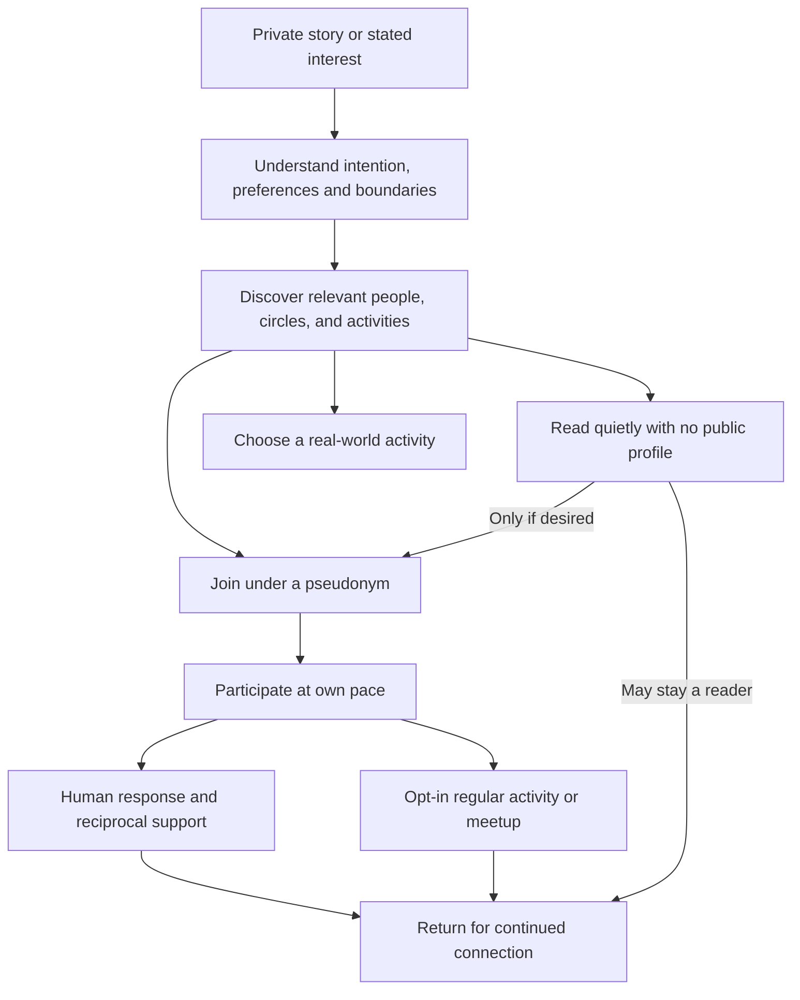
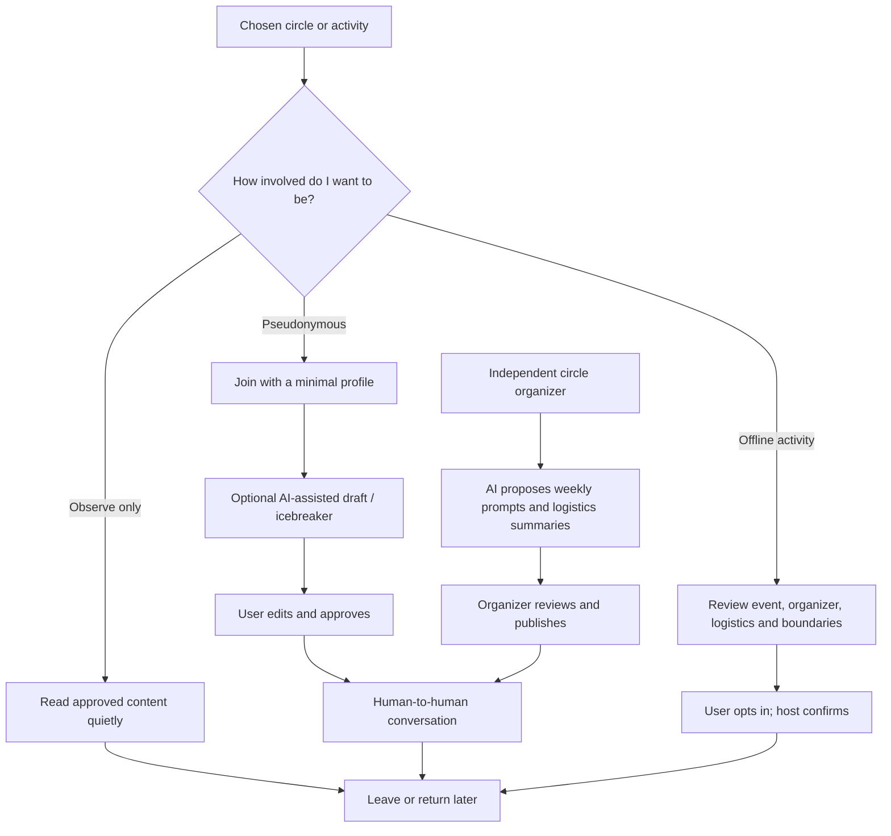

# Beyond Silence | Community Lifecycle, Participation Models, and Four Demo Stories

Version 1.1 | 27 October 2026 | Product-thinking companion to `BUILD_SPEC.md`

## 1. The product's bigger promise

Beyond Silence must not stop at "understand a story and recommend a group." Discovery is a means, not an outcome. The real product promise is helping someone move from an isolated, sensitive experience to an acceptable form of human support, and making that support sustainable at the individual's chosen level of participation.

**North Star:** A person finds an appropriate connection, activity, or trustworthy source of lived experience without revealing more than they choose, and can return without feeling obligated to disclose or perform emotional vulnerability.

This is peer connection and social belonging, **not diagnosis, medical treatment, or a substitute for professional care.** It must also work for people who reject mental-health branding, formal organizations, therapy-like interactions, or disclosure to strangers.

### Participation is a ladder, not a mandatory funnel

Do not imply that every user must progress toward chat, offline meetings, or revealing their identity. Quiet participation can be a valid endpoint.

## 2. Four specific stories to narrate

These are **fictional demo personas**, not user research. Avoid pretending they are real testimonials.

### Story A: Arjun, 29 | "I need somebody who understands, not a decision made for me"

- **Situation:** Married for four years in Hyderabad. Considering separation, but parents oppose divorce and friends know the family.
- **Friction:** Existing searches focus on divorce or legal processes. He is actually seeking a confidential, nonjudgmental listener who understands family expectations.
- **What he will not do:** Publish his full story, join a visibly branded mental-health organization, or accept unsolicited advice.
- **Product experience:** Types his story privately -> receives editable interpretation (family pressure, privacy, lived experience) -> compares contextual and keyword-ranked circles -> previews exactly what a pseudonymous introduction exposes -> finds an opted-in peer circle -> reads quietly or posts a short introduction -> a fictional peer replies in the prototype.
- **Ongoing AI role:** Optional, clearly marked conversation starters based on the *circle's stated purpose*, not on members' private narratives; suggestions must require the human to approve before posting.
- **User-level value:** Finds a plausible relevant human conversation with less unsolicited disclosure.
- **Hackathon role:** **PRIMARY complete three-minute demo.** The core result must work without external APIs in v1 and later use real Meta AI in the final build.

### Story B: Kabir, 27 | "I don't want a support group. I want somewhere to belong"

- **Situation:** Moved to Hyderabad for work, feels lonely, has stopped exercising, and struggles to build a routine.
- **Friction:** Therapy-branded spaces and emotional sharing sessions don't appeal to him; sports or gym groups do, but ordinary search shows generic fitness listings without an easy path to recurring companionship.
- **What he will not do:** Identify as a mental-health user, reveal private emotional history to a gym group, or attend a formal support-group meeting.
- **Product experience:** Says "I want to get out more but don't know anyone" -> AI interprets need as routine + activity-based social connection -> shows opt-in Saturday badminton, group walks, and beginner gym buddies -> he selects an activity under a neutral public identity -> attends if and when he chooses.
- **Ongoing AI role:** Helps an independent volunteer host draft weekly activity posts, summarizes **publicly shared and consented** logistics, and suggests low-pressure re-engagement, not guilt-inducing reminders.
- **User-level value:** Regular low-stakes social contact without requiring a mental-health label.
- **Hackathon role:** **SECONDARY illustrated story**, one mock activity card and a short visual explanation only. Do not build scheduling, payments, maps, or physical attendance in the first sprint.

### Story C: Samira, 31 | "I want to understand my options without anyone knowing I'm here"

- **Situation:** Family conflict and emotional strain. She shares devices at home and fears disclosure or retaliation.
- **Friction:** Even creating a profile, joining a visible group, receiving push notifications, or composing a message can feel unsafe.
- **What she will not do:** Join a group, reveal identity, accept invitations, or disclose details to peers.
- **Product experience:** Opens low-disclosure educational or curated lived-experience previews -> reads without becoming publicly visible -> can optionally save nothing, copy relevant resources, or leave. There is **no required account and no required conversation.**
- **Ongoing AI role:** Makes existing approved discussions easier to understand and navigate, without exposing the reader or inventing peer testimony. Private summaries should never imply verified safety or confidentiality.
- **User-level value:** Accesses relevant information while retaining the option not to participate.
- **Hackathon role:** **SECONDARY privacy variant** represented through "Read quietly" mode and copy explaining participation is optional.
- **Crucial caveat:** "Not visible to community members" is not the same as "undetectable" or "no digital trace." A production system must address browser history, notifications, logs, metadata, shared devices and appropriate safety escalation. Do not claim guaranteed anonymity or use a fake quick-exit control as a safety guarantee.

### Story D: Meera, 36 | "I've been through this. I can help, but I don't want to join an organization"

- **Situation:** Has navigated grief and family pressure and would like to share her experience occasionally.
- **Friction:** She doesn't want to be hired, credentialed as a therapist, managed as a volunteer by a formal organization, or responsible for counseling strangers around the clock.
- **What she will not do:** Represent herself as a clinician, promise 24/7 availability, or sacrifice her own well-being to moderate a community.
- **Product experience:** Opts in as an independent experienced peer, selects discussion topics and boundaries, offers limited availability, moderates her own participation, can pause or step back, and is not assigned people involuntarily.
- **Ongoing AI role:** Proposes optional discussion topics, draft welcome replies, weekly recaps of explicitly shareable content, and flags posts for human review. It must **never automatically post as Meera**, invent lived experiences, fabricate testimonials, or replace consented human availability.
- **User-level value:** Can contribute genuine experience without becoming part of an institution or acting as a therapist.
- **Hackathon role:** **SUPPLY-SIDE story**, one illustrated post-connection suggestion card showing how human-led communities remain active.

The words "don't want to work under an organization" are interpreted here as voluntary, independent contributors and participants who reject institutional affiliation. If the intended group is instead independent clinicians or nonprofit organizers, their credentials, governance and responsibilities would require a distinct workflow.

## 3. What happens after matching?

**Product lifecycle:** Discover -> evaluate trust -> choose participation depth -> connect -> participate -> sustain -> disengage or return.

### Where Meta AI adds value throughout the lifecycle

| Stage | User-facing value | Potential model capability | Critical boundary |
|---|---|---|---|
| Express | Understand unstructured, multilingual experiences | Muse Spark reasoning; voice transcription later | Allow correction; don't diagnose |
| Discover | Find people and activities by social intent, not only keywords | Context extraction and reranking | Don't invent peers or match scores |
| Decide | Explain why an option fits and what data will be shared | Reasoning applied to consented profile attributes | User must control disclosure |
| Observe | Surface public/approved discussions, with understandable summaries | Grounded summarization | No private-message harvesting |
| Participate | Suggest editable icebreakers or introductions | Draft generation | No auto-posting under a human identity |
| Sustain | Offer organizer-approved weekly prompts, topic ideas, recaps and activity announcements | Generation + summarization | Human approval, no fake user engagement |
| Maintain trust | Flag harmful or policy-breaking language for designated reviewers | AI triage and classification | Human decisions, privacy, no promise of automatic crisis handling |
| Re-engage | Offer low-pressure reminders for opted-in circles or recurring activities | Preference-aware assistance | Opt-in; avoid emotionally coercive notifications |

The most credible demo of post-connection AI is **"Help me say it"**: a draft grounded in the individual's confirmed sharing preferences that the person can inspect and send themselves. A second credible demo is **"Suggested weekly topic"** visible to a volunteer host, explicitly marked as unposted until approval. Neither capability requires pretending a model can create genuine human engagement.

## 4. Identity and participation modes

| Mode | Visible to others | Allowed actions | What it does not promise |
|---|---|---|---|
| Quiet reader | No public member introduction | View preview content specifically authorized for public/visitor reading | Not invisibility to the hosting system/device |
| Pseudonymous member | Chosen alias, selected shared fields | Join circle, react or send messages | Pseudonymity is not full anonymity |
| Activity participant | Organizer-approved display name and minimum logistics fields | Request attendance in a scheduled recurring activity | Offline anonymity cannot be guaranteed |
| Independent peer host | Display name, self-declared relevant experience and availability | Approve conversations/topics, publish prompts, withdraw | Not a qualified professional unless verified |

In the initial Next.js mock, only **quiet reading** and **pseudonymous circle participation** are interactive. The activity and independent-host modes appear as a clearly labeled **future concept preview**.

### Participation choices as product copy

- `I'd rather read first` -> quiet mode; no compelled message.
- `I want to talk, but stay private` -> select alias and approved introduction.
- `I'd rather do something together` -> preview recurring non-clinical activities.
- `I have experience to share` -> preview independent-peer-host role.

No user should have to self-identify as a patient, disclose a diagnosis, or join an organization to use the conceptual experience.

## 5. The first prototype's precise scope

### P0: implement within the existing five-stage Arjun journey

1. Keep the full Share -> Understand -> Discover -> Join -> Connect flow as currently specified.
2. At Discover, show `Read circle preview` on relevant circle cards. It opens a mock public/visitor preview of permitted posts. The viewer has no public alias and has not joined. `Continue to join` goes to the existing Join stage; `Back to results` returns to discovery. No actual backend or privacy guarantees.
3. In Connect, add `Help me say it` offering **two fixed, fixture-driven drafts** for the current narrative, e.g. "I'm mainly looking for somebody who understands family expectations. I'd appreciate listening before advice" and "I may mostly read for now. Thanks for making space." Selecting a draft fills an editable composer but NEVER sends it. Label `Sample draft, not live AI`.
4. In Connect, show a compact "Keep this circle going" preview with one fictional weekly topic drafted for an independent host; label `Illustrative suggestion. Organizer approval required.` This is read-only in P0.
5. On landing or a subtle `Explore other ways to connect` drawer/card, show the other three scenario cards (Kabir, Samira, Meera) as **illustrative concepts**. Do not route their stories through Arjun's hardcoded AI interpretation.
6. The default three-minute demonstration must remain uncluttered. The primary path remains Arjun; post-join draft demonstrates sustainable, user-controlled participation in under ~20 seconds.

### P1: if there is time after the core journey is stable

- A fixture-driven activity card for Kabir showing `Saturday badminton / beginner gym / evening walk`, marked as illustrative; no calendar or reservation functionality.
- Organizer-facing one-click **approve/reject** for a mock weekly community topic (client-only and stateful).
- Simulated return visit showing a previously approved weekly topic in the feed.
- Localized sample text variants (do not claim live voice/language coverage).

### Explicitly defer to after the hackathon

No real activity check-ins, location services, physical meetup check-in, safety verification, payments, public user discovery, automated DMs, autonomous moderation, real professional pathways, real peer recruitment, anonymous email or messaging, real Meta consumer-platform integrations, or algorithmically inferred mental-health state. Those require evidence, product governance and technical readiness that are not present in a mock prototype.

## 6. Revised three-minute storyboard

| Time | Scene | On-screen evidence | Purpose |
|---|---|---|---|
| 0:00-0:20 | Problem / user | Arjun's familiar, private dilemma | Why this matters |
| 0:20-0:45 | Share | Editable story with clear privacy copy | Low-friction entry |
| 0:45-1:12 | Understand | AI-style contextual insights, marked simulated | First model-value hypothesis |
| 1:12-1:40 | Discover | Context-aware vs topic-only comparison | Differentiation |
| 1:40-2:03 | Privacy choice | Quiet reading optional; selected alias and exact intro | Control, not forced disclosure |
| 2:03-2:30 | Human connection | Fictional peer reply; editable `Help me say it` draft | Human-centered outcome and ongoing engagement |
| 2:30-2:45 | Sustain | Host-approved recurring prompts; optional activity-based belonging | Value after matchmaking |
| 2:45-3:00 | Close | What Meta models will power; actual vs future evidence | Technical importance and honest limitations |

**Video disclosure:** Phase-1 video is a concept/prototype review. It cannot be presented as proof of actual Muse API usage until a later integration is working and demonstrated. All sample peers, conversation content, AI interpretations, and community suggestions are synthetic.

## 7. Product success metrics by phase

**Hackathon prototype (demonstrable):** flow completion, ability to choose quiet mode, no unexpected disclosure in posted preview, draft never auto-posts, end-to-end reset, sample scenario clarity. No claims of measured clinical benefit or actual companionship.

**With real Meta models:** independent relevance ratings against topic-only baseline, error rates in context extraction, user correction rate, explanation consistency, opt-in disclosure leakage tests, moderation triage evaluation.

**Real pilot (post-hackathon, only with proper readiness):** percentage finding at least one acceptable option, time-to-first-consented-human-reply, repeat opted-in participation, perceived relevance and sense of being understood, independent host effort saved, trust/safety incident rates, repeat attendance for voluntary activities. Report denominators and avoid conflating posts with well-being gains.

## 8. Two-stage plan: win the hackathon, then refine over two months

### Until hackathon submission (Nov 4, 2026 ET)

- Freeze one reliable Arjun narrative, mock fixture-driven five-step product, transparent privacy preview and post-connection draft.
- Polish video-first UX and repeat the whole journey twice with no broken interactions.
- Later, integrate one real Meta Muse Spark inference and a same-candidate-pool comparison if time and access permit; distinguish that final build from the mock.
- Record a polished 3-minute story, not a catalog of unfinished features.

### Eight weeks after submission: research and product refinement

- **Weeks 1-2:** Interview people who prefer anonymous support, activity-based social connection, and independent peer hosts. Validate which gap they actually experience. Do not assume each persona is a validated market segment.
- **Weeks 3-4:** Usability-test quiet reading, privacy comprehension, disclosure controls, and trust in matching explanations. Decide whether the target wedge is peer conversations or activity-led belonging.
- **Weeks 5-6:** Build evaluated real contextual matching against consented peer/activity profiles; test corrections, privacy failures, and multilingual behavior. Draft community operations principles with human oversight.
- **Weeks 7-8:** Pilot a narrowly bounded community only if consent, moderation, safeguarding, and peer-host availability are ready. Measure real participation and independent-host workload; do not call it a clinical intervention.

### Strategic product question

**Are we a better way to find emotional peer support, or a better way to build belonging through shared activities and independent communities?** Both may fit the long-term product, but the hackathon wedge is the first. The eight-week research period should determine whether the second becomes a major product surface or a separate use case.

## 9. Concrete Codex acceptance additions

- B01: From Discover, `Read circle preview` opens fictional shareable content without creating a public member identity.
- B02: A quiet reader is not forced to join, send, or reveal details to continue browsing or exit.
- B03: From Connect, selecting one of two clearly simulated suggested drafts fills the composer but does not send a message automatically.
- B04: Editing a selected draft before sending changes exactly what appears in the user message.
- B05: A post-connection weekly community prompt is shown as a fictional draft and cannot impersonate a real volunteer or auto-publish.
- B06: Three other scenario cards are visible as product concept examples but cannot accidentally use Arjun's hardcoded interpretation.
- B07: Restart clears selected drafts, preview state, messages and any other demo-local state.
- B08: Tests assert the introduction uses only explicitly approved content and reading previews does not append the user to simulated membership or disclose story text.

**Priority rule:** P0 remains important, but do not compromise a stable main demo or fail existing tests merely to add P1 features.
